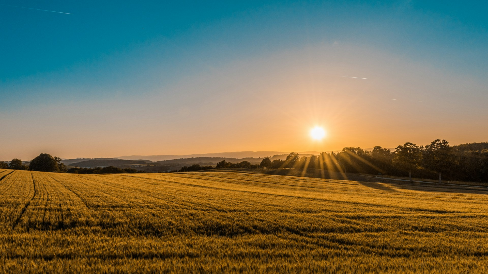

# Mahalekshmi Goshala (മഹാലക്ഷ്മി ഗോശാല)

> A living home for India's cattle heritage, rooted in Thiruvalla, Kerala, and shaped by generations of care. Associated with the heritage of Mahalekshmi Silks.



---

## 🌟 Overview

**Mahalekshmi Goshala** is a modern, high-aesthetic web application for the cattle sanctuary located in Mundiappally, Thiruvalla, Pathanamthitta District, Kerala. The website preserves and showcases indigenous Indian cattle breeds (Gir, Vechur, Sahiwal, Kasaragod Dwarf, and more), humane dairy practices, daily pastoral rhythms, and provides an interactive visitor walkthrough inquiry system.

The project features a **pure bilingual experience** (English & authentic agricultural Malayalam) with 0% language leakage across both modes.

---

## ✨ Features

- **Cinematic Experience**: 4K video reel player, smooth micro-interactions, responsive typography, and pure white aesthetic design.
- **Indigenous Breed Archive**: Interactive catalog of native cattle lineages with origin maps, behavioral temperament, physical characteristics, and heritage significance.
- **Rhythm of the Day**: Timeline exploration covering morning nutrition routines, grooming, free-grazing, rest cycles, and twilight care.
- **Bilingual System (EN / ML)**:
  - English Mode: 100% pure English (zero script leakage).
  - Malayalam Mode: Culturally rich, authentic agricultural Malayalam (*തനത് കാർഷിക ഭാഷ*).
- **Interactive Live Map**: Custom branded Leaflet marker centered at the farm coordinates (`9.425375, 76.623375`) in Mundiappally, Thiruvalla with direct Google Maps route navigation.
- **Visitor Walkthrough Inquiry**: Interactive booking modal with date selection, party size, purpose of visit, and sanctuary etiquette protocols.
- **Media Lightbox & Video Player**: Fullscreen photograph lightbox and modal documentary video player connected to the official YouTube channel (`@mahalekshmigoshala1265`).

---

## 🛠️ Tech Stack

- **Framework**: [React 19](https://react.dev/) + [TypeScript](https://www.typescriptlang.org/)
- **Bundler & Tooling**: [Vite](https://vitejs.dev/)
- **Styling**: [Tailwind CSS](https://tailwindcss.com/)
- **Icons**: [Lucide React](https://lucide.dev/)
- **Maps**: [Leaflet](https://leafletjs.com/) with official OpenStreetMap tiles
- **Deployment Ready**: Optimized production bundle with code splitting and zero linter/type errors.

---

## 🚀 Getting Started

### Prerequisites

- Node.js (v18 or higher recommended)
- npm or yarn

### Installation

```bash
# Clone the repository
git clone <your-repo-url>
cd mahalekshmi-goshala

# Install dependencies
npm install
```

### Running Locally

```bash
# Start the development server
npm run dev

# Or run the preview server
npm run build
npm run preview
```

Open `http://localhost:5173/` in your browser.

---

## 📂 Project Structure

```
mahalekshmi-goshala/
├── public/                # Static assets & photography
│   └── images/
├── src/
│   ├── components/        # Reusable UI components (Navbar, Footer, LiveMap, Modals)
│   ├── context/           # LanguageContext (EN / ML state management)
│   ├── data/              # Config, site data & translation dictionaries
│   │   ├── siteConfig.ts
│   │   └── translations.ts
│   ├── sections/          # Page sections (Hero, Story, Farm, Breeds, Life, Visit)
│   ├── types/             # TypeScript definitions
│   ├── App.tsx            # Main application root
│   └── main.tsx           # Entry point
├── scripts/               # Translation generation utilities
└── tailwind.config.js     # Tailwind design system configuration
```

---

## 📍 Location & Contact

- **Location**: Mundiappally, Thiruvalla, Pathanamthitta District, Kerala 689581
- **Official YouTube**: [@mahalekshmigoshala1265](https://www.youtube.com/@mahalekshmigoshala1265)
- **Parent Brand**: [Mahalekshmi Silks](https://mahalekshmisilks.com)
